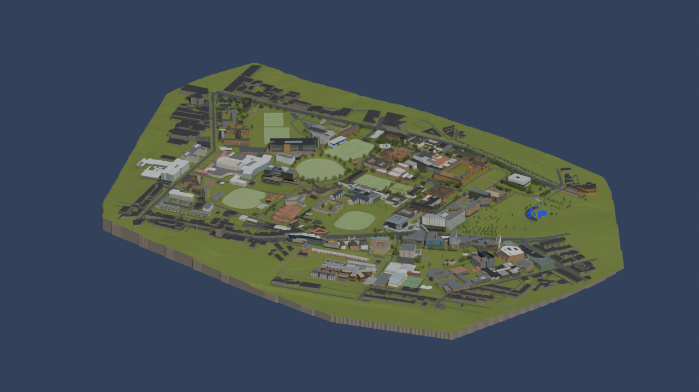

# University of Sydney Campus 3D Reconstruction

## Latest progress snapshot — 25 October 2026

[P245-env-rootfix3-progress-20261025: files and previews](https://github.com/z-hstudio/usyd-campus-reconstruction/releases/tag/P245-env-rootfix3-progress-20261025) · [Changes and checks](docs/releases/P245-env-rootfix3-progress-20261025/RELEASE-NOTES.md)

This progress prerelease includes the checked Blender scene, a fresh GLB with corrected grass colours, current mapped data and source notices. It remains a partial personal reconstruction. Earlier stable releases are preserved below; the linked release notes explain the sampled checks and remaining limits.

Model by Manyousang Z / z-hstudio. Map data © OpenStreetMap contributors. See the release's source notices for the full credits.

## Earlier Community Edition information

**Camperdown / Darlington — Public Community Edition**  
**Manyousang Z / z-hstudio** · Creator: Manyousang Z（漫游桑 Z） · Author: Ziheng Huang（黄子恒）

A source-available, approximate campus model for creative and educational use. **Not an OSI open-source project and not survey data.**

| Use | Terms |
|---|---|
| Personal learning, education, research, non-commercial display/video/web/game/VR/AR, modification and redistribution | Permitted for the author's contribution under [Community License 1.0](LICENSE.md), with mandatory source credit |
| Modified or converted editions | Keep the original credit and add `Modified by [Name].` |
| Commercial apps/games/services/digital twins/client work/advertising/paid assets | Separate **prior written commercial permission** required; terms negotiated |
| Commercial credit | **Commercial permission does not waive attribution.** |
| Third-party data and assets | Retain independent [ODbL / CC BY / CC0 terms](THIRD_PARTY_NOTICES.md); this licence cannot narrow those rights |

Required English credit:

> Based on the original 3D campus model by
> Manyousang Z / z-hstudio.

中文：

> 本作品基于漫游桑 Z（Manyousang Z）/ z-hstudio
> 制作的原始校园三维模型。

Place credits where users can reasonably find them. Renaming, remeshing, retexturing and file conversion do not erase the author's original contribution. See [attribution and modified-work examples](ATTRIBUTION.md) and [commercial licensing](COMMERCIAL-LICENSE.md).

## Release status

The current Community Edition is published through the GitHub Releases listed in the repository. Each downloadable asset is accompanied by a release manifest and SHA256 list. The current basis is P245. Large binaries belong in GitHub Release assets, not this Git history.

[Release history](HISTORY.md) · [Provenance](RIGHTS_AND_PROVENANCE.md) · [Sources](SOURCES.md) · [Public/private differences](PUBLIC_EDITION_LIMITATIONS.md) · [Contributing](CONTRIBUTING.md)

## Accuracy and independence

This is a visual and creative reconstruction, not registered survey data, construction documentation, legal boundaries, safety navigation, a precise digital twin or an official model. Building heights, façades, roofs, roads and vegetation include historical references and reasonable visual estimates.

This is an independent community reconstruction project.
It is not affiliated with, endorsed by, or officially produced by the university.

University names, logos and trademarks belong to their respective owners. No official endorsement or trademark licence is implied. Private source assets are not part of this repository.
